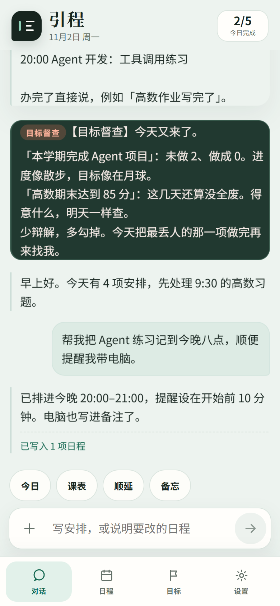

# 引程

引程是一款面向大学生与备考用户的本地优先学习规划工作台。它把课程表、日程、长周期学习计划和目标督查放在同一个时间体系中，并通过确定性校验避免 AI 模型“只说已写入、实际没有写入”的问题。

官网：[https://yincheng-planner.pages.dev/](https://yincheng-planner.pages.dev/)



## 功能

- 自然语言创建、修改、顺延和完成日程。
- 按学期周次管理单双周、节次、教室与教师。
- 高数/数学二等长周期计划使用本地课纲展开，每天内容按章节递进。
- 缺少必要日期时保存结构化草稿，只追问一次。
- 支持固定学习时间和自动避开课程、日程后寻找空档。
- 目标每日对照相关日程，支持本地或模型督查。
- 日程搜索覆盖标题、备注、地点、课程、教师、周次与日期。
- 数据默认保存在手机本机，支持 JSON 备份与恢复。
- Capacitor Android 应用，核心功能可离线使用。

## 技术栈

- 前端：原生 HTML、CSS、JavaScript
- Android：Capacitor 6 + Java
- 本地数据：`localStorage`
- 官网：Cloudflare Pages
- 下载统计：Cloudflare Pages Functions + KV
- 模型接口：OpenAI 兼容 Chat Completions API

## 快速开始

### 运行网页版

```bash
npm install
npx cap sync android
python -m http.server 4173 --directory www
```

打开 `http://localhost:4173`。

### 构建 Android APK

准备 JDK 17、Android SDK 34 后：

```bash
npm install
npm run android:build
```

输出位置：

```text
android/app/build/outputs/apk/release/app-release.apk
```

正式签名：

1. 复制 `android/keystore.properties.example` 为 `android/keystore.properties`。
2. 填写自己的 keystore 路径、别名和密码。
3. 不要把签名库或配置文件提交到 Git。
4. 重新运行 `npm run android:build`。

## 测试

```bash
npm run test:flow
npm run test:study
npm run test:search
node scripts/test-timetable.js
```

浏览器测试需要 Playwright 和 Chromium/Edge：

```bash
python scripts/test-agent-actions.py http://127.0.0.1:4173
python scripts/test-mobile-ui.py http://127.0.0.1:4173
```

## 官网

源码位于 `official-site/`。

```bash
cd official-site
npm install
npm run build
npx wrangler pages deploy public --project-name yincheng-planner --branch main
```

部署前需要在 `official-site/wrangler.toml` 配置自己的 Cloudflare KV 命名空间。

## 数据与隐私

- 日程、课表、目标、备忘录和对话默认保存在当前设备。
- API Key 不进入导出备份。
- 只有用户主动配置第三方模型接口时，相关提示词和上下文才会发送到该接口。
- 官网只统计安装包下载次数，不读取用户账号信息。

## 目录

```text
www/                Web 应用与本地规划逻辑
android/            Capacitor Android 工程
official-site/      官网、Cloudflare Functions 与 KV 下载计数
scripts/            回归测试和移动端自动化测试
```

## 参与贡献

请先阅读 [CONTRIBUTING.md](CONTRIBUTING.md)。提交前确保测试通过，并且没有加入 API Key、签名库或个人配置。

安全问题请按 [SECURITY.md](SECURITY.md) 私下报告。

## 许可证

[MIT](LICENSE)
